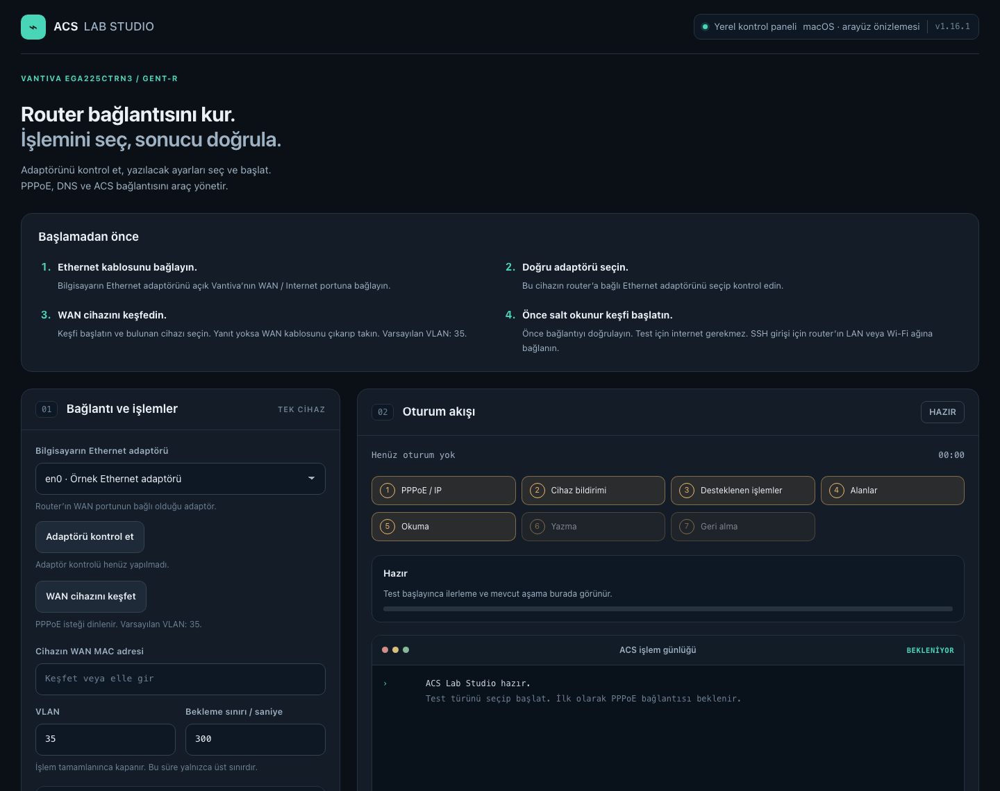
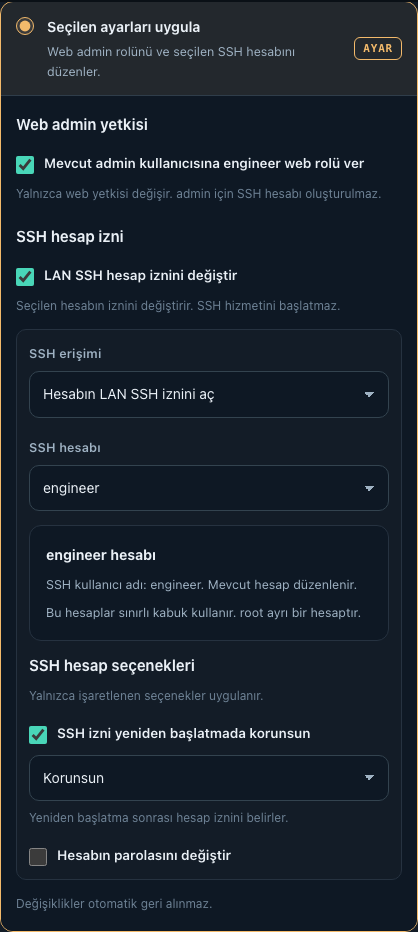
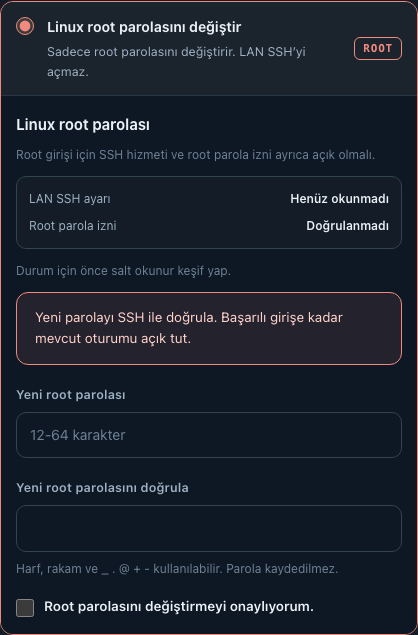

# ACS Lab Studio

**Vantiva EGA225CTRN3 / GENT-R** için yerel test ve yönetim aracı. Web admin yetkisini düzenleyebilir, router'ın root parolasını belirleyebilir ve LAN SSH erişimini açabilirsiniz. Sürüm: **v1.17.2**.

**Denenen cihaz:** Mushu 23.1.a, `23.1.a.0698-1521021`; web arayüzü `EGA225CTRN-R2-RC4`. macOS üzerinden sıfırlanmış laboratuvar cihazında root parolası ve SSH terminal erişimi doğrulandı. Diğer cihaz ve firmware sürümleri için uyumluluk garanti edilmez.

## Başlamadan önce

**Router yapılandırmanızın ve önemli verilerinizin yedeğini alın; geri yükleme yöntemini öğrenin.** Studio tam cihaz yedeği almaz. Yalnızca sahibi olduğunuz veya yönetmeye yetkili olduğunuz cihazlarda kullanın. Kullanımdan doğabilecek erişim kaybı, veri kaybı ve hizmet kesintisi dahil tüm sonuçların sorumluluğu kullanıcıya aittir. Yazılım garanti verilmeden sunulur.

## 1. İndirin ve kurulumu tamamlayın

[Son release'i açın](https://github.com/bucagdas/acs-lab-studio/releases/latest). **Assets** bölümünden `acs-lab-studio-*.zip` dosyasını indirip çıkarın. Kurulumu internet bağlantınız varken tamamlayın.

| Sistem | İlk kurulum | Başlatma |
| --- | --- | --- |
| macOS | Python 3.9+, Scapy, pppd ve OpenSSL gerekir. Python paketleri için aşağıdaki komutları kullanın. | `Baslat.command` dosyasını açın. |
| Linux | [Linux kurulumunu](GUIDE.md#linux---deneysel) tamamlayın. **Deneyseldir; gerçek donanım doğrulaması bekliyor.** | Klasörde `sh Baslat.sh` çalıştırın. |
| Windows | [Windows kurulumunu](WINDOWS.md) tamamlayın: Python, WSL 2 ve Npcap; ardından `Kurulum.cmd` ve `Kontrol.cmd`. **Deneyseldir.** | `Baslat.cmd` dosyasını yönetici olarak açın. |

<details>
<summary>macOS ve Linux: Python paketlerini kurma</summary>

Python 3.9 veya üzeri kurulu olmalıdır. Studio klasöründe Terminal açıp çalıştırın:

```sh
python3 -m venv .venv
.venv/bin/python3 -m pip install -r requirements.txt
```

Linux'ta önce [gerekli sistem paketlerini](GUIDE.md#linux---deneysel) kurun. Başlatıcı bağımlılıkları otomatik kurmaz. Eksik bileşen bildirirse [teknik kılavuzu](GUIDE.md#başlatma) kontrol edin.

</details>

Güncellemede Studio'yu kapatıp yeni dosyaları mevcut klasöre yazın; `.runs/` ve `.state/` klasörlerini koruyun. Windows güncellemesi için [Windows kılavuzunu](WINDOWS.md#kayıtlar-güncelleme-ve-kapanış) izleyin.

## 2. Kabloları ve router'ı hazırlayın

1. Router açık kalsın. WAN / Internet portundaki operatör veya ONT kablosunu çıkarın; testi operatör bağlantısından ayrı yapın.
2. Bilgisayarın Ethernet portunu router'ın **WAN / Internet** portuna bağlayın. USB veya dahili Ethernet kullanılabilir.
3. Router'ın web arayüzünde **CWMP / TR-069 etkin** olsun. Studio işlemleri bitene kadar kapatmayın.
4. SSH veya web arayüzünü kullanacaksanız bilgisayarı ayrıca **bu router'ın Wi-Fi ağına** bağlayın. Alternatif olarak ikinci bir Ethernet bağlantısıyla router'ın LAN portunu kullanın.

**Sadece WAN kablosu yeterli mi?**

| Amaç | Gerekli bağlantı |
| --- | --- |
| Studio ile keşif, test ve ayar uygulama | Bilgisayarın Ethernet portu → router'ın **WAN / Internet** portu |
| Router'ın web arayüzü veya SSH ile giriş | Bilgisayar → router'ın **Wi-Fi ağı veya LAN portu** |

Kurulum tamamlandıktan sonra ACS işlemleri için internet gerekmez. WAN kablosu ayar aktarımı içindir; SSH doğrulamasında Wi-Fi veya LAN bağlantısını kullanın.

## 3. Studio'yu açın ve bağlantıyı kontrol edin

1. Sisteminizin başlatıcısını açın. Yönetici parolası istenirse **bilgisayarınızın parolasını** girin. Terminal penceresi açık kalsın.
2. Tarayıcıdan **http://127.0.0.1:8890** adresini açın.
3. WAN kablosunun bağlı olduğu **Ethernet adaptörünü** seçip **Adaptörü kontrol et** düğmesine basın. VLAN'ı, özel bir değişiklik yapmadıysanız **35** bırakın.
4. **WAN cihazını keşfet** düğmesine basıp bulunan cihazı seçin. Cihaz bulunamıyorsa WAN kablosunu çıkarıp tekrar takın; keşif siz durdurana veya paket gelene kadar bekler.
5. Önce **Salt okunur keşif**, tamamlanınca **Standart log aktarımı testi** çalıştırın. Her işlemin sonucunu kontrol edin; işlem bitince ağ oturumu otomatik kapanır.

**Router'ın LAN IP adresi otomatik bulunmaz.** Sıfırlanmış cihazda genellikle `192.168.1.1` olur. Daha önce değiştirdiyseniz paneldeki LAN yönetim IP alanına gerçek adresi yazın. Bu alan web ve SSH bağlantısı içindir.

## 4. Yapmak istediğiniz işlemi seçin

### Router'a root SSH erişimi açmak

1. **Linux root parolasını değiştir** modunu seçin. Buradaki parola **router'ın root hesabına** aittir; bilgisayarınızın parolası değişmez.
2. Yeni parolayı iki kez girin.
3. **LAN SSH hizmetini ve root parola girişini de aç** seçeneğini işaretleyin. Bu seçenek root terminal erişimini de açar. İşaretlenmezse yalnızca parola değiştirilir.
4. Onay kutusunu işaretleyip **Root parolasını değiştir** düğmesine basın.
5. Aktarım tamamlanınca, router'ın Wi-Fi veya LAN ağına bağlı bilgisayarda yeni bir Terminal açın:

```sh
ssh root@192.168.1.1
```

Router'ın LAN IP'si farklıysa komutta o adresi kullanın. Studio'da belirlediğiniz yeni parolayı girin. **`root@OpenWrt:~#` istemini görmeniz başarılı terminal erişimini doğrular.** Panelde aktarımın tamamlanması tek başına SSH girişini doğrulamaz. Mevcut bir SSH oturumunuz varsa yeni giriş başarılı olana kadar açık tutun.

### Web admin kullanıcısına engineer yetkisi vermek

**Seçilen ayarları uygula** modunda **Mevcut admin kullanıcısına engineer web rolü ver** seçeneğini işaretleyip işlemi başlatın. Sonrasında router'ın web arayüzünden çıkış yapıp mevcut **admin adı ve web parolasıyla** yeniden giriş yapın.

Web admin yetkisi, engineer/superuser CLI hesapları ve root SSH erişimi ayrı işlemlerdir. Admin'e engineer web rolü vermek admin için SSH hesabı oluşturmaz. Diğer hesap seçenekleri ve yazma/geri alma testi için [teknik kılavuza](GUIDE.md) bakın.

## 5. İşlemler bittikten sonra

Aynı operatör altyapısında kullanıma devam edecekseniz, WAN/ONT kablosunu geri takmadan önce router'ın web arayüzünden **CWMP / TR-069'u kapatın**. Operatörün yönetim sunucusu ayarları yeniden uygulayabilir. Studio işlemleri tamamlanmadan CWMP'yi kapatmayın.

İşlem bittikten sonra Studio'yu Terminal'de `Ctrl+C` ile kapatabilirsiniz. Yazma/geri alma sürerken programı zorla kapatmayın.

## Ekran görüntüleri

Görseller v1.16.1 arayüz önizlemeleridir. Güncel root ve LAN SSH adımları yukarıda açıklanmıştır.



<details>
<summary>Web rolü, SSH hesap izni ve root parola seçenekleri</summary>





</details>

## Kayıtlar ve kurtarma

Oturumlar `.runs/`, kurtarma kayıtları `.state/` içinde tutulur; hassas cihaz bilgileri içerebilir. Bu klasörleri paylaşmayın ve bekleyen geri alma kaydı varken silmeyin. Kesinti sonrası **Ağ ayarını kurtar** düğmesini kullanın; bu işlem router bağlantısı gerektirmez.

Ayrıntılı kurulum ve kurtarma: [GUIDE.md](GUIDE.md). Windows desteği: [WINDOWS.md](WINDOWS.md). Sürüm geçmişi: [CHANGELOG.md](CHANGELOG.md).

## Lisans ve yazar

**Lisans:** [GNU General Public License v2.0](LICENSE) (`GPL-2.0-only`). Kullanabilir, değiştirebilir ve ticari olarak dağıtabilirsiniz. Dağıtılan türetilmiş sürümlerin kaynak kodu aynı lisansla sunulmalı; telif ve lisans bildirimleri korunmalıdır. Üçüncü taraf bileşenler kendi lisanslarına tabidir.

**Author:** [bucagdas](https://github.com/bucagdas)

Copyright (c) 2026 bucagdas.

