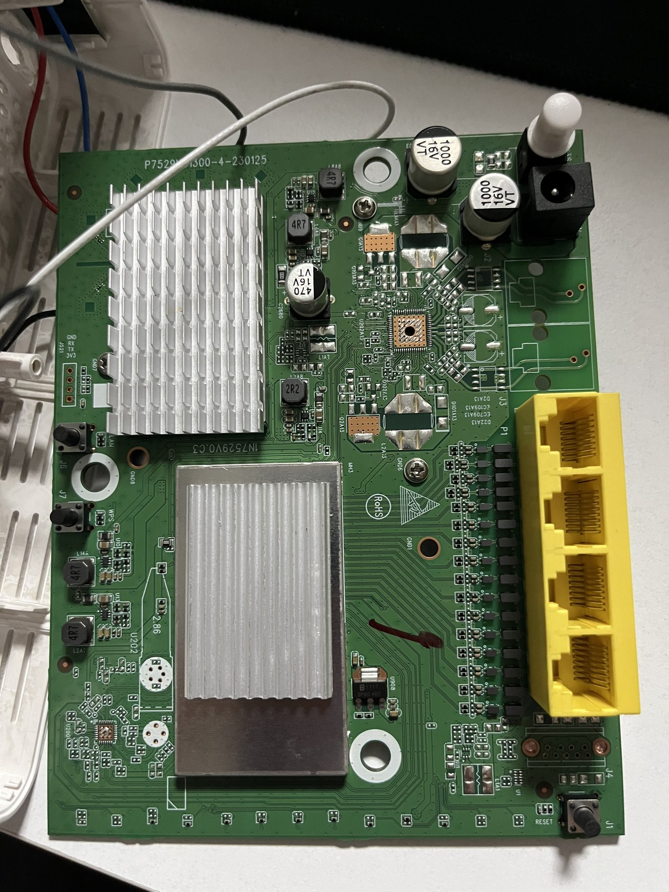
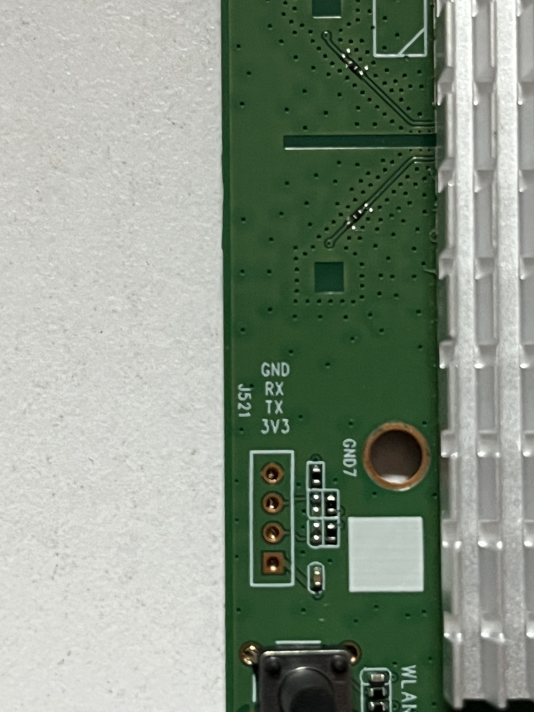

# Vantiva EGA225CTRN3 / GENT-R donanımı

Bu fotoğraflar test cihazının anakartını ve UART bağlantı noktalarını gösterir. **ACS Lab Studio kullanmak için cihazı açmak veya UART bağlantısı kurmak gerekmez.**

## Anakart

## UART bağlantı noktaları

Yakın çekimde kart üzerindeki **J521** bağlantısı ve **GND, RX, TX, 3V3** etiketleri görülür. Etiketler fotoğraftan okunmuştur; bu sayfa ölçümle doğrulanmış bir bağlantı kılavuzu değildir. Farklı kart revizyonlarında yerleşim değişebilir.

Fotoğraflar: [bucagdas](https://x.com/bucagdas). Paylaşılan JPEG kopyaları küçültülmüş ve EXIF dahil gömülü fotoğraf metaverileri temizlenmiştir.
